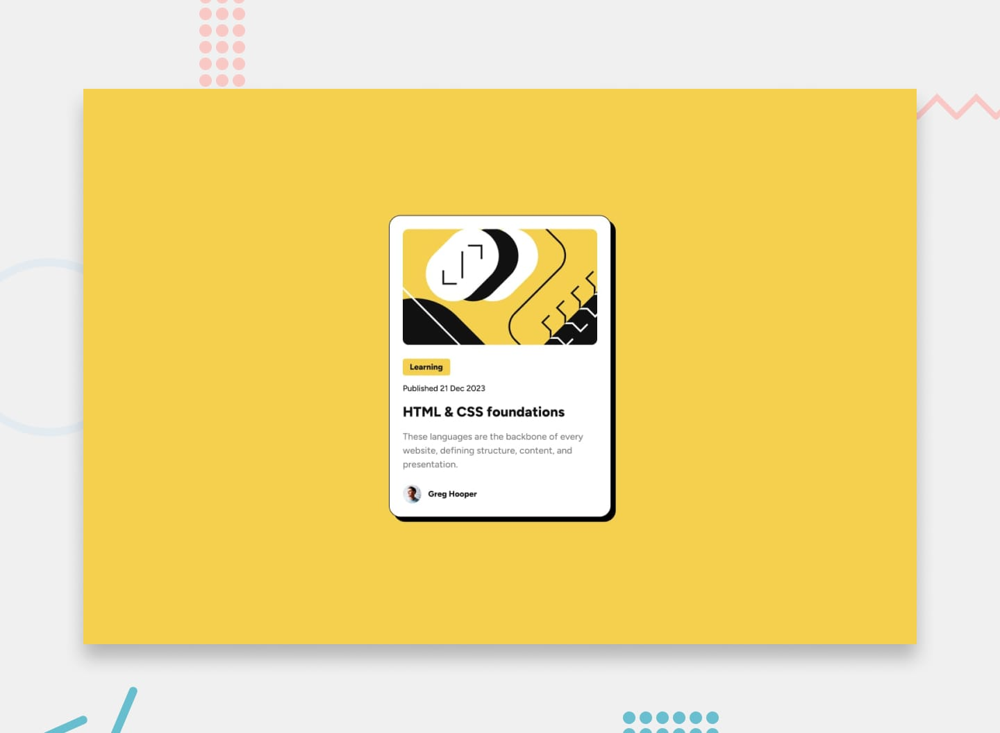

# Blog Preview Card

Projeto desenvolvido como parte dos desafios do [Frontend Mentor](https://www.frontendmentor.io/), com o objetivo de praticar e consolidar conhecimentos de HTML e CSS.

## 📸 Preview

## 🎯 Objetivo

Reproduzir um componente de visualização de artigo (*Blog Preview Card*) seguindo o design disponibilizado pelo Frontend Mentor.

O desafio envolve a construção de um card responsivo, trabalhando estrutura semântica, estilização e organização do layout.

## 🛠️ Tecnologias utilizadas

- HTML5
- CSS3
- Flexbox
- Google Fonts (Figtree)

## 📋 Funcionalidades e requisitos

- Estrutura inicial do card.
- Aplicação da paleta de cores.
- Implementação da tipografia Figtree.
- Centralização e ajustes de layout.
- Responsividade.
- Estado de hover
- Revisão final comparando com o design original.

## 💻 Desenvolvimento

O projeto está sendo desenvolvido utilizando HTML e CSS, priorizando a organização do código, a semântica HTML e a utilização de boas práticas de estilização.

## 👨‍💻 Autor

**João**

- GitHub: [@Dev-jaoo](https://github.com/Dev-jaoo)
- Frontend Mentor: [Seu perfil](https://www.frontendmentor.io/profile/Dev-jaoo)